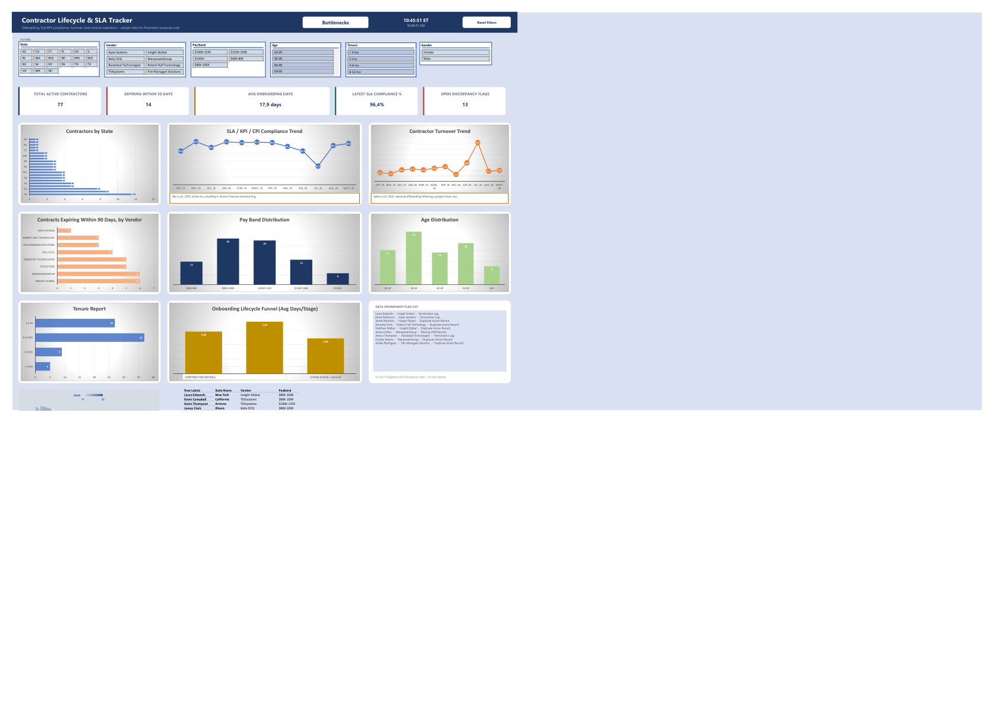
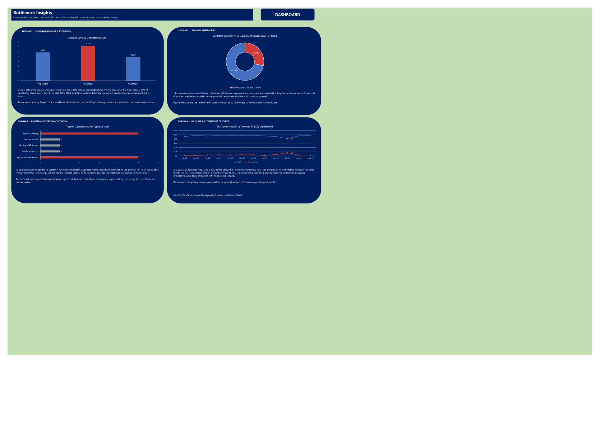

# 07 — Contractor Lifecycle & SLA Tracker (Excel)

**What it does:** The same "Contractor Lifecycle" concept as [project 06](../06-contractor-lifecycle-dashboard/), rebuilt natively in Excel with VBA — click-to-filter charts, a dual-timezone (US ET / HU) live header clock, and a slicer-connected "Bottlenecks" worksheet that surfaces 4 specific findings (slowest onboarding stage, top vendor by near-term expirations, turnover spike month, data discrepancy list) computed directly from pivot data, not hardcoded text.

Includes a companion PowerPoint guide walking through how the dashboard was built and what each finding means.

## Screenshots

**Dashboard (top half):**

**Dashboard (bottom half):**

**Bottlenecks worksheet:**

## Key techniques

- VBA-driven click-to-filter: clicking a chart data point sets slicer selections across the whole workbook, no manual filter clicks needed.
- A dedicated "Bottlenecks" sheet computes 4 findings live from pivot tables/charts rather than being static commentary — reruns correctly if the underlying data changes.
- Dual-timezone header clock (US Eastern + Hungary) updates via a VBA `OnTime` timer loop.

## Files

- `CEO_Executive_Dashboard.xlsm` — the workbook (macros enabled; sample data for illustration only)
- `Contractor_Lifecycle_Dashboard_Guide.pptx` — a slide walkthrough of the dashboard and the 4 Bottleneck findings

**Stack:** Excel, VBA, PivotTables/PivotCharts, slicers.

---

_All data is synthetic — a fictional contractor/vendor portfolio for illustration only._
