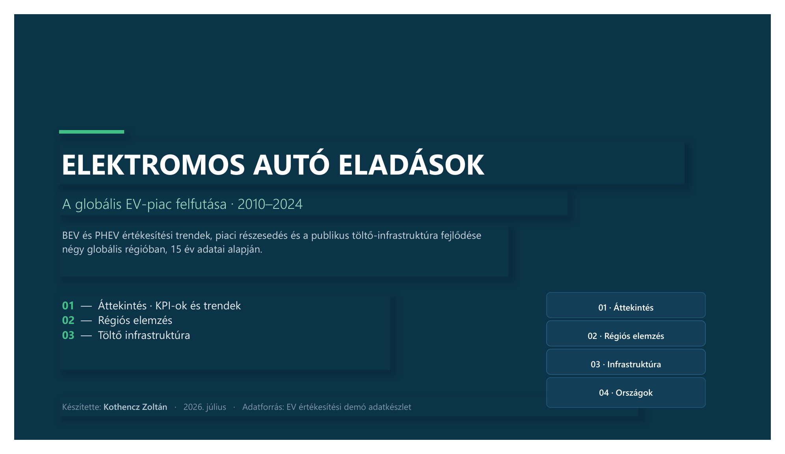
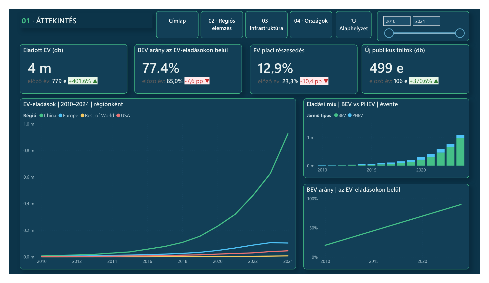

# 09 — EV Sales & Charging Infrastructure (Power BI)

**What it does:** A global electric vehicle market report covering BEV/PHEV sales trends, market share, and public charging infrastructure growth across four regions (China, Europe, USA, Rest of World), 2010–2024.

## Screenshots

Full report (4 pages: Overview, Regional analysis, Charging infrastructure, Countries): [09-powerbi-ev-sales.pdf](09-powerbi-ev-sales.pdf)

## Key techniques

- Time-intelligence measures (YoY %, trend lines) over a 15-year monthly grain.
- Regional drill-down from a single "Overview" page into country-level detail via bookmarks/navigation buttons.
- KPI cards with built-in prior-year comparison arrows (▲/▼) driven by DAX, not static text.

**Stack:** Power BI Desktop, DAX, Power Query.

---

_All data is a synthetic EV sales demo dataset._
