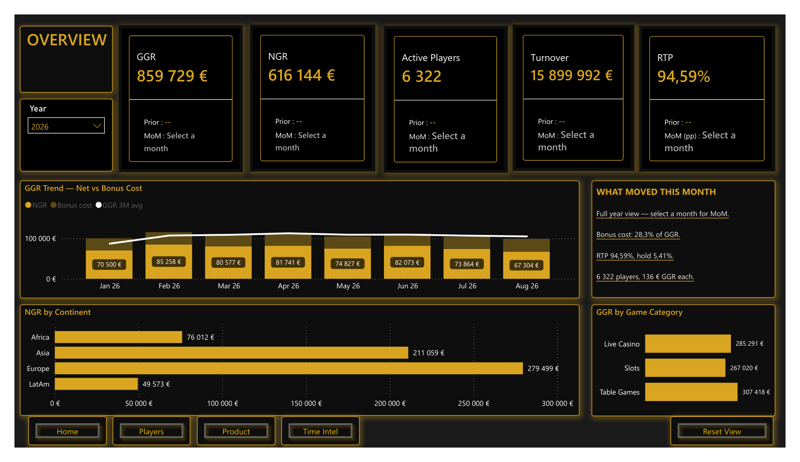

# 10 — iGaming Operations Report (Power BI)

**What it does:** An online gaming operator's performance report — GGR/NGR, active players, turnover, RTP/hold, bonus cost, and player demographics/geography, broken down by month and by game category (Live Casino, Slots, Table Games).

## Screenshots

Full report (5 pages: Overview, Players, Product, Time Intel): [10-powerbi-igaming-report.pdf](10-powerbi-igaming-report.pdf)

## Key techniques

- "What Moved This Month" narrative panel — auto-generated commentary (bonus cost %, hold %, GGR-per-player) driven by DAX measures, not hardcoded text, so it stays correct as the selected month changes.
- Player geography breakdown drilling from continent to country in a single matrix visual.
- GGR trend combo chart layering NGR, bonus cost, and a 3-month moving average in one view.

**Stack:** Power BI Desktop, DAX, Power Query.

---

_All data is a synthetic iGaming operations demo dataset — player-level rows are aggregated, no individual player identities are shown._
