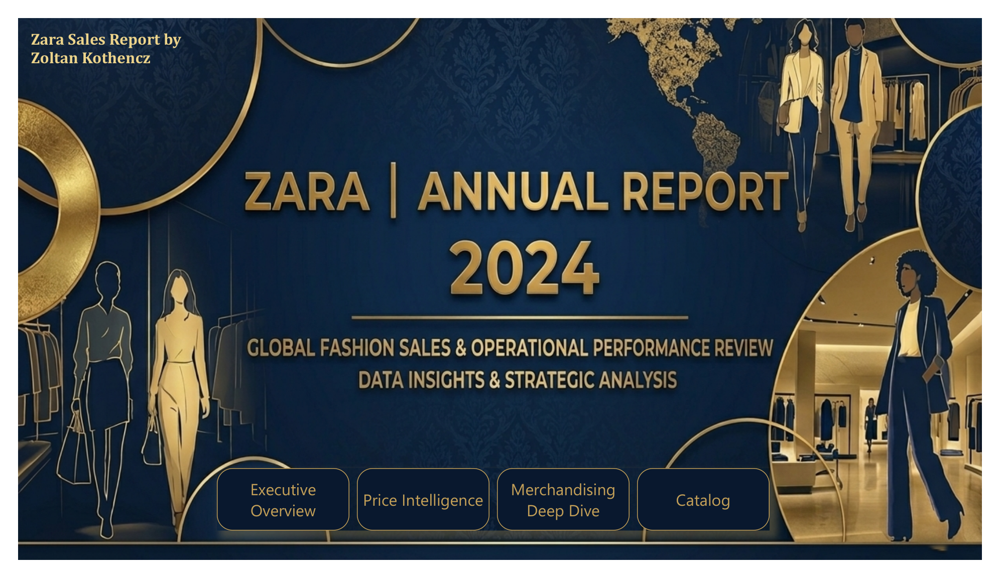
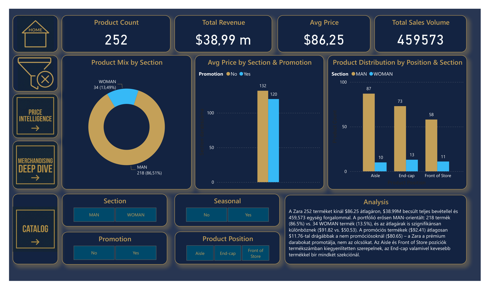

# 11 — Zara Sales & Merchandising Analysis (Power BI)

**What it does:** A retail sales and merchandising report analyzing Zara's product catalog — revenue, pricing, promotion effectiveness, and in-store product placement (aisle / end-cap / front-of-store), split by section (Man/Woman).

## Screenshots

Full report (5 pages: Executive Overview, Price Intelligence, Merchandising Deep Dive, Catalog): [11-powerbi-zara-sales.pdf](11-powerbi-zara-sales.pdf)

## Key techniques

- Auto-generated written analysis panel (portfolio mix %, price gap by promotion, position distribution) computed from DAX measures rather than hardcoded per screenshot.
- Promotion-vs-price interaction chart showing Zara promotes premium items, not discount stock — a genuine, non-obvious finding surfaced by the model.
- Cross-filtering catalog browser tying every visual back to a single product-level fact table.

**Stack:** Power BI Desktop, DAX, Power Query.

---

_All data is a synthetic retail sales demo dataset._
