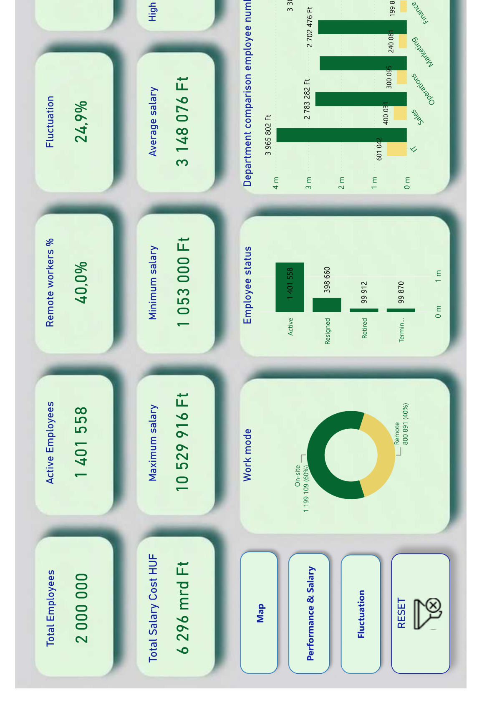
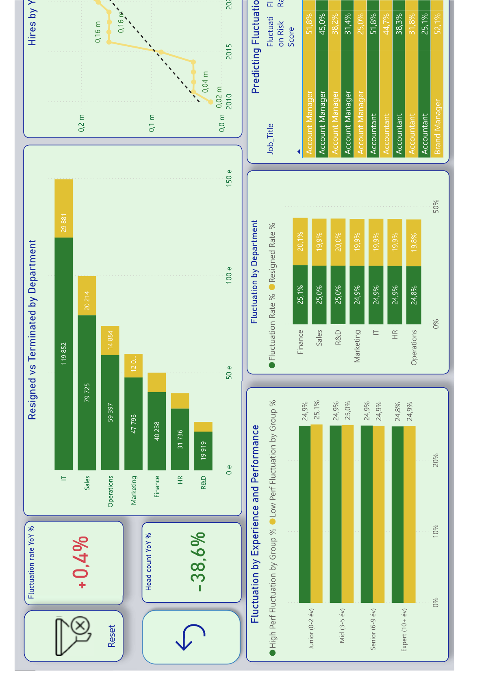

# 12 — HR Analytics Dashboard (Power BI)

**What it does:** A workforce analytics report — headcount, salary distribution, remote/on-site mix, and turnover/fluctuation risk by department, tenure band, and performance level, across a 2,000,000-employee synthetic dataset.

## Screenshots

**Executive Summary:**

**Fluctuation & retention risk:**

Full report (4 pages: Executive Summary, Map, Performance & Salary, Fluctuation): [12-powerbi-hr-analytics.pdf](12-powerbi-hr-analytics.pdf)

> Note: the "Map" page and the per-employee salary table (Performance & Salary page) are intentionally left out of the screenshots/PDF above — the map visual depends on an Azure Maps sign-in this static export can't render, and the salary table is skipped here to avoid publishing a person-level list even though the names are synthetic.

## Key techniques

- Fluctuation-risk scoring by job title, blending resignation rate and performance tier into a single risk score.
- Work-mode (remote/on-site) and department-comparison visuals cross-filtered from one employee-status donut.
- YoY hires trend with a linear trendline overlay for quick eyeballing of hiring deceleration.

**Stack:** Power BI Desktop, DAX, Power Query.

---

_All data is a synthetic HR demo dataset (2M synthetic employee records)._
