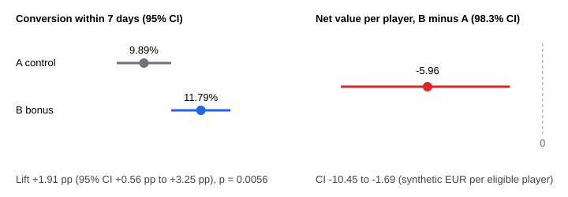

# 14 - A/B Test: reactivation bonus email (design, randomisation, SRM check, analysis, decision)

**What it does:** Runs a complete A/B test on synthetic data, in the order a real one runs. A CRM team wants to know whether adding a 100% deposit match (up to 50) to the first-deposit reminder email raises first deposits. The script writes the plan and the decision rule first, assigns players to arm A (standard reminder) or B (reminder + bonus) with a hash-based split in SQL, checks the split, measures every player in a fixed window, tests the result, and applies the decision rule mechanically. It is the experimentation companion to project 13 (funnel and reactivation list) and project 01 (retention).

The point of the demo is the method, not the result: sample size before the test, randomisation that cannot be gamed, a broken-split check, a value metric next to the conversion metric, and a verdict that was fixed in advance.

## Key techniques

- **Pre-registered plan in code.** One primary metric, one guardrail, a smallest lift worth acting on, the sample size it needs (3 841 per arm for 10% to 12%), and a three-way decision rule (`SHIP B`, `DO NOT SHIP B`, `INCONCLUSIVE`) are fixed in the `PLAN` dict before any outcome exists. `decide()` applies them without discretion.
- **Randomisation in SQL** (`sql/01_assign.sql`): `ab_hash(player_id, salt) % 100 < 50`. The same player always lands in the same arm, a new salt gives an independent split. In Snowflake the same line is `MOD(ABS(HASH(player_id, salt)), 100) < 50` (BigQuery equivalent in the file comments). SQLite has no hash function, so a SHA-256 stand-in is registered from Python.
- **Exclusions before the split**, in both arms alike: already deposited, responsible-gaming flag, no email consent. The eligibility flow (`LAG` for players removed per step) shows who dropped out.
- **Sample ratio mismatch (SRM) check:** chi-square on the arm sizes against the planned 50/50, with the usual 0.001 threshold. A failing SRM makes the verdict `INVALID`, because a broken assignment means no result can be trusted. Covariate balance (channel, country) is tested too.
- **Fixed per-player windows** (`sql/02_player_metrics.sql`): every outcome is measured from that player's own email day (7 days for conversion, 14 days for value), so late enrolees get as long as early ones. `LEFT JOIN` keeps non-depositors as zeros, and `ROW_NUMBER` picks the first deposit inside the window.
- **Two-proportion z-test** with a confidence interval for the conversion difference, **percentile bootstrap** intervals for heavy-tailed money metrics, **Bonferroni** alpha for the three secondary tests (0.05 / 3), and a **winsorized** rerun to see whether outliers drive the conclusion.
- **Value next to conversion:** net value per eligible player = GGR over 14 days minus the bonus at face value. A conversion win that loses money is the classic bonus-test trap.
- **Peeking simulation:** 1 000 simulated A/A tests show how checking daily and stopping at the first p < 0.05 inflates false positives.

Every item above is covered by `test_ab.py` (see "How it is tested").

## Files

| File | What it does |
|---|---|
| `run_experiment.py` | Plan, data generation, runs the SQL steps, analysis, decision rule, report writer |
| `ab_stats.py` | Statistics helpers (z-test, sample size, power, SRM, chi-square, bootstrap, winsorize, peeking simulation), stdlib only |
| `sql/01_assign.sql` | Eligibility filter and hash-based assignment (`assignments` table) |
| `sql/02_player_metrics.sql` | One row per player: conversion, first deposit, bonus cost, 14-day GGR, unsubscribe |
| `sql/03_reports.sql` | Eligibility flow, enrolment per day, per-arm totals, balance tables, exploratory channel split |
| `test_ab.py` | 18 plain-assert tests |
| `output/experiment_report.md` | The full report; `experiment_results.csv`, `sample_size_table.csv`, `peeking_simulation.csv`, the report queries as CSV and `ab_summary.svg` |

## How to run

```bash
cd 14-ab-test-bonus-email
python run_experiment.py    # builds ab_test.db, writes output/ (about 3 seconds)
python test_ab.py           # plain asserts, no pytest needed
```

**Requirements:** Python 3.9+ (stdlib only) and SQLite 3.25+ (window functions). No network. The data is deterministic (fixed seeds), and two runs give byte-identical output files. `ab_test.db` is git-ignored. The code was checked for Python 3.9 syntax with `ast`; it was run on Python 3.14 only.

## How to read the output (sample from a real run)

### The design

| item | value |
|---|---|
| arms | A = standard reminder, B = reminder + 100% deposit match up to 50 |
| unit | player, assigned once |
| primary metric | first deposit within 7 days of the email |
| secondary metrics | first-deposit amount per eligible player; net value per eligible player (GGR 14 days minus bonus) |
| guardrail | unsubscribe within 7 days must not rise significantly |
| baseline, smallest lift | 10% baseline, +2.0 percentage points |
| alpha, power | 0.05 two-sided, 80% |
| required sample | 3 841 players per arm |

### Who is in the test

| step | stage | players | removed |
| ---- | ----- | ------- | ------- |
| 1 | candidates (KYC passed, 3 days ago) | 11000 | 0 |
| 2 | after: not deposited before | 9904 | 1096 |
| 3 | after: no responsible-gaming flag | 9590 | 314 |
| 4 | after: email consent = ELIGIBLE | 8186 | 1404 |

4 116 players in A and 4 070 in B, enough for the planned +2.0 pp (power 82%). SRM check: chi-square 0.258, p = 0.611, so the split is fine. Channel mix (p = 0.324) and country mix (p = 0.533) are balanced across arms.

### Results

| metric | role | A control | B bonus | B minus A | confidence interval | p-value |
| ------ | ---- | --------- | ------- | --------- | ------------------- | ------- |
| conversion within 7 days | primary | 9.89% | 11.79% | +1.91 pp | +0.56 pp to +3.25 pp (95%) | 0.0056 |
| first-deposit amount per player | secondary | 12.87 | 13.14 | +0.27 | -2.81 to +3.23 (98.3%) | bootstrap |
| net value per player (GGR 14d - bonus) | secondary | 6.07 | 0.11 | -5.96 | -10.45 to -1.69 (98.3%) | bootstrap |
| unsubscribe within 7 days | guardrail | 0.92% | 1.13% | +0.21 pp | -0.33 pp to +0.74 pp (98.3%) | 0.3528 |

The bonus raised conversion by about 19% relative (+1.91 pp), and the guardrail held. But the net value per eligible player is lower in B: of the -5.96, -5.07 is the bonus cost and -0.89 is the GGR difference (GGR on its own is very noisy and is not tested separately). Capping the top and bottom 1% of net value gives -3.36 (98.3% CI -5.69 to -1.30), so outliers do not drive the conclusion.

**Verdict by the pre-set rule: `DO NOT SHIP B`.** It is not a statement that bonuses lose money, see the limitations.



### Why peeking is forbidden

1 000 simulated A/A tests (both arms identical, so every "win" is a false positive), 3 836 players per arm, 14 daily looks:

| how the data is read | false-positive rate |
|---|---|
| one look at the planned end | 5.8% |
| check every day, stop at the first p < 0.05 | 23.3% |

### Sample size by smallest detectable lift (baseline 10%, alpha 0.05, power 80%)

| lift | players per arm |
|---|---|
| +1.0 pp | 14 751 |
| +1.5 pp | 6 693 |
| +2.0 pp | 3 841 |
| +2.5 pp | 2 507 |
| +3.0 pp | 1 774 |

Halving the lift you want to detect needs about four times the players.

## How it is tested

`test_ab.py` checks the statistics against hand-computed and textbook values (chi-square 5% points, the 3 841 sample size, a worked z-test), proves that SRM flags a 4 000 / 4 400 split, and checks the data rules: one arm per player, excluded players never assigned, assignment identical on a rebuild, a different salt reshuffles about half of the players, no bonus in arm A or after the 7-day offer, and every window complete at the snapshot date. The strongest test re-derives every player's conversion, first deposit, bonus, 14-day GGR and unsubscribe flag in Python from the raw tables and compares them with the SQL result.

To check that the tests can fail, I broke the project on purpose four ways (window of 8 instead of 7 days, the responsible-gaming exclusion removed, a 55/45 split, the bonus leaking into arm A); each break turned a test red. Those mutation runs were done by hand, they are not part of the repo.

## Limitations

- **All data is synthetic and the effects are set by me in the generator.** The bonus multiplies every player's conversion chance by 1.25 (about +2.4 pp on a 9.6% base; the estimate of +1.9 pp is inside its interval). The deposit sizes, the stake and win distribution and the bonus rule are chosen, not measured. I set the scenario up so that conversion wins while 14-day value does not, because that is a common real pattern. The money result is therefore a property of the generator, not a finding about real players.
- **The bonus is costed at face value.** A real cost depends on wagering requirements and forfeited bonuses and is usually lower. The value window is only 14 days; a longer window (30 or 60 days) could pay a bonus back. Revenue is GGR (stake minus win) minus bonus, not NGR: taxes and fees are not modelled.
- **One send, one audience, one bonus size.** No repeat deposits, no repeated emails, no novelty effect, no interference between players (shared tournaments, leaderboards). Players who deposit after day 7 get no bonus and are counted as non-converters.
- **Normal approximation.** The z-test is fine at these counts; with a few dozen conversions use an exact test. Bootstrap intervals are percentile intervals with 2 000 resamples.
- **Multiple testing:** Bonferroni covers only the three secondary and guardrail tests. The channel table in `output/conversion_by_channel.csv` is exploratory and untested: slicing until something is "significant" is how A/B tests fool people.
- **The responsible-gaming exclusion is simulated** (a flag in the data). In production it is a compliance rule that must not depend on any model.
- **SQLite only.** The window function and `CASE` logic is standard SQL, but `date()` and the registered `ab_hash` function would change for another database.

_All data is synthetic. No real player, operator or company data was used._
