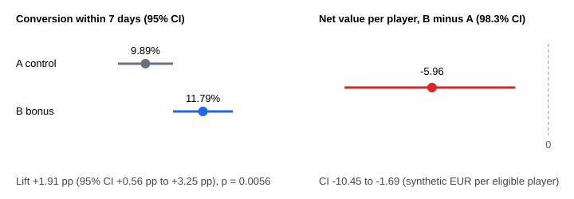

# A/B Test Report: reactivation bonus email

Synthetic data. GGR = stake - win; net value = GGR - bonus face value (not NGR: no taxes or fees).

## 0. Plan (fixed before any outcome)

| item              | value                                                                                                                                                                                                                                          |
| ----------------- | ---------------------------------------------------------------------------------------------------------------------------------------------------------------------------------------------------------------------------------------------- |
| hypothesis        | Adding a 100% deposit match (up to 50) to the first-deposit reminder email raises the share of players who make a first deposit within 7 days.                                                                                                 |
| arms              | A = standard reminder, B = reminder + 100% deposit match up to 50                                                                                                                                                                              |
| unit              | player (one email per player, assigned once)                                                                                                                                                                                                   |
| primary metric    | first deposit within 7 days of the email (conversion, per eligible player)                                                                                                                                                                     |
| secondary metrics | first-deposit amount per eligible player; net value per eligible player = GGR (14 days) - bonus cost                                                                                                                                           |
| guardrail         | unsubscribe within 7 days (must not rise significantly)                                                                                                                                                                                        |
| baseline / MDE    | 10% baseline, +2.0 pp smallest lift worth acting on                                                                                                                                                                                            |
| alpha / power     | 0.05 two-sided / 80%                                                                                                                                                                                                                           |
| secondary alpha   | 0.0167 (Bonferroni, 3 tests)                                                                                                                                                                                                                   |
| required sample   | 3841 players per arm                                                                                                                                                                                                                           |
| decision rule     | SHIP B only if primary p < alpha with a positive lift AND the net-value CI lies fully above 0 AND the guardrail holds. DO NOT SHIP if the primary fails, the net-value CI lies fully below 0, or the guardrail breaks. Otherwise INCONCLUSIVE. |

## 1. Who is in the test (eligibility flow)

| step | stage                               | players | removed |
| ---- | ----------------------------------- | ------- | ------- |
| 1    | candidates (KYC passed, 3 days ago) | 11000   | 0       |
| 2    | after: not deposited before         | 9904    | 1096    |
| 3    | after: no responsible-gaming flag   | 9590    | 314     |
| 4    | after: email consent = ELIGIBLE     | 8186    | 1404    |

Required 3841 per arm, available 4116 (A) and 4070 (B). Power to detect the planned +2.0 pp with the available sample: 82%.

## 2. Did the randomisation work?

- Sample ratio check (planned 50/50): A = 4116, B = 4070, chi-square = 0.258, p = 0.6112 -> **OK** (fails only below 0.001).
- Channel mix equal across arms: chi-square = 4.66, df = 4, p = 0.3239.
- Country mix equal across arms: chi-square = 4.12, df = 5, p = 0.5326.

| channel     | a_players | b_players | a_share_pct | b_share_pct |
| ----------- | --------- | --------- | ----------- | ----------- |
| affiliate_a | 1059      | 976       | 25.73       | 23.98       |
| affiliate_b | 822       | 842       | 19.97       | 20.69       |
| affiliate_c | 582       | 607       | 14.14       | 14.91       |
| crm_email   | 591       | 612       | 14.36       | 15.04       |
| organic     | 1062      | 1033      | 25.8        | 25.38       |

Enrolment ran for 14 consecutive days (two full weeks), see `output/enrolment_by_day.csv`.

## 3. Results

| metric                                 | role      | A control | B bonus | B minus A | confidence interval          | p-value   |
| -------------------------------------- | --------- | --------- | ------- | --------- | ---------------------------- | --------- |
| conversion within 7 days               | primary   | 9.89%     | 11.79%  | +1.91 pp  | +0.56 pp to +3.25 pp (95%)   | 0.0056    |
| first-deposit amount per player        | secondary | 12.87     | 13.14   | +0.27     | -2.81 to +3.23 (98.3%)       | bootstrap |
| net value per player (GGR 14d - bonus) | secondary | 6.07      | 0.11    | -5.96     | -10.45 to -1.69 (98.3%)      | bootstrap |
| unsubscribe within 7 days              | guardrail | 0.92%     | 1.13%   | +0.21 pp  | -0.33 pp to +0.74 pp (98.3%) | 0.3528    |

Raw totals per arm:

| variant | players | converted_7d | conv_pct | unsub_7d | unsub_pct | avg_first_deposit_of_converters | ggr_14d  | bonus_cost | net_value | net_value_per_player |
| ------- | ------- | ------------ | -------- | -------- | --------- | ------------------------------- | -------- | ---------- | --------- | -------------------- |
| A       | 4116    | 407          | 9.89     | 38       | 0.92      | 130.15                          | 24983.76 | 0.0        | 24983.76  | 6.07                 |
| B       | 4070    | 480          | 11.79    | 46       | 1.13      | 111.42                          | 21067.4  | 20640.0    | 427.4     | 0.105                |

Relative lift of the primary metric: +19.3%. The average first deposit of converters in the table above is descriptive only: it compares players who converted, and the bonus changes who converts.

Where the net-value difference of -5.96 per eligible player comes from: GGR difference -0.89 (not tested on its own, GGR is very noisy) and bonus cost -5.07 (B only).

## 4. Robustness: outliers

Net value is heavy-tailed (a few large depositors). Capping the top and bottom 1% of net value (at -195.02 and 258.16) gives B minus A = -3.36, 98.3% CI -5.69 to -1.30. The conclusion about net value is the same as without capping.

## 5. Verdict (rule from section 0, applied mechanically)

**DO NOT SHIP B.** Conversion rose, but net value per player (14-day GGR minus the bonus at face value) is significantly lower in B than in A.

What this verdict does not say: the bonus is costed at its face value (a real cost depends on wagering requirements and forfeits, so it is usually lower); only the first 14 days of value are counted (a longer window could pay a bonus back); it is one audience and one bonus size. The money figures follow from the generator settings, not from a real operator.

## 6. Why the plan forbids peeking

1000 simulated A/A tests (both arms identical, so every 'win' is a false positive), 3836 players per arm, 14 daily looks, alpha 0.05:

| how the data is read                                   | false-positive rate |
| ------------------------------------------------------ | ------------------- |
| one look at the planned end                            | 5.8%                |
| check every day, stop at the first p < 0.05 (14 looks) | 23.3%               |

## 7. Sample size by smallest detectable lift (baseline 10%, alpha 0.05, power 80%)

| lift to detect | players per arm |
| -------------- | --------------- |
| +1.0 pp        | 14751           |
| +1.5 pp        | 6693            |
| +2.0 pp        | 3841            |
| +2.5 pp        | 2507            |
| +3.0 pp        | 1774            |

_Generated from synthetic data. No real player data._
